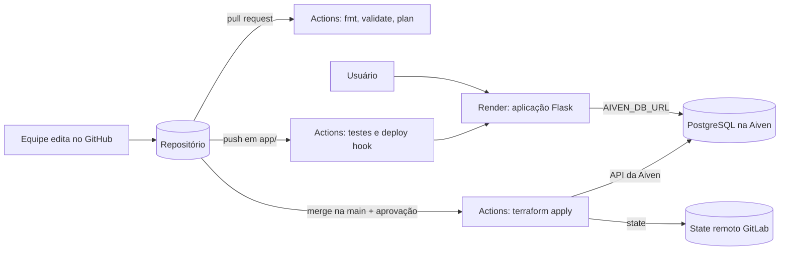

# Arquitetura

O diagrama abaixo usa Mermaid, que o GitHub desenha automaticamente. Revise-o e
acrescente o que sua equipe mudar.

## Caminho dos segredos

| Segredo | Onde fica | Quem usa |
|---|---|---|
| `AIVEN_API_TOKEN`, `AIVEN_PROJECT` | Secrets do GitHub | Workflows do Terraform |
| `TF_STATE_*` | Secrets do GitHub | Workflows do Terraform |
| `RENDER_DEPLOY_HOOK_URL`, `APP_HEALTHCHECK_URL` | Secrets do GitHub | Workflow do app |
| `AIVEN_DB_URL` | Variável de ambiente no Render | Aplicação |
