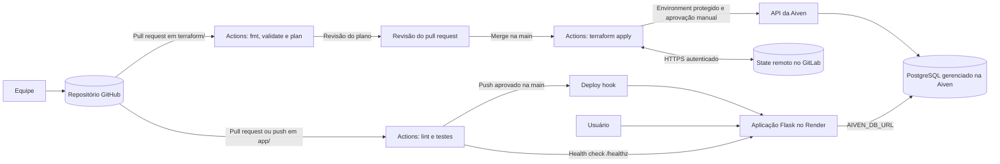

# Arquitetura

O sistema é uma aplicação Flask de gestão de laboratórios de TI e equipamentos.
O código fica no GitHub, a aplicação é executada no Render e os dados são
armazenados em PostgreSQL gerenciado na Aiven. O Terraform descreve os recursos
da Aiven. O state é armazenado remotamente no GitLab para que as execuções do
pipeline usem o mesmo estado.

## Diagrama

## Fluxo de CI/CD

1. Ao abrir ou atualizar um pull request com alterações em `terraform/`, o
   GitHub Actions executa `terraform fmt -check`, `terraform validate` e
   `terraform plan`. A equipe revisa o plano antes de integrar as mudanças.
2. Depois do merge na branch `main`, o workflow de aplicação executa o
   `terraform apply` usando o Environment protegido. A etapa de produção fica
   aguardando a aprovação manual de um revisor antes de alterar a infraestrutura
   na Aiven.
3. Mudanças em `app/` acionam o workflow da aplicação: ele inicia um PostgreSQL
   de teste, executa lint e testes e, após push aprovado na `main`, aciona o
   deploy no Render. Ao final, consulta `/healthz` para verificar se a aplicação
   consegue acessar o banco.
4. O workflow manual de destroy remove a infraestrutura quando autorizado e
   após a confirmação exigida pelo próprio workflow.

Os eventos e proteções acima descrevem o fluxo esperado. Antes da entrega,
confira os gatilhos, filtros de caminho e regras de aprovação nos arquivos reais
de `.github/workflows/` e nas configurações do Environment do repositório.

## Caminho dos segredos e credenciais

| Nome | Onde é armazenado | Quem utiliza e para quê |
|---|---|---|
| `AIVEN_API_TOKEN` | GitHub Actions Secret | Provider Aiven nos workflows Terraform; autentica chamadas à API da Aiven. |
| `TF_STATE_ADDRESS` | GitHub Actions Secret | Backend HTTP do Terraform; endereço do state remoto no GitLab. |
| `TF_STATE_USERNAME` | GitHub Actions Secret | Backend HTTP; usuário usado para autenticar no state remoto. |
| `TF_STATE_PASSWORD` | GitHub Actions Secret | Backend HTTP; token de acesso ao state remoto. |
| `AIVEN_DB_URL` | Variável de ambiente protegida no serviço Render | Aplicação Flask; URI de conexão com o PostgreSQL. Contém credenciais e não deve aparecer em código, logs ou gravações. |
| `RENDER_DEPLOY_HOOK_URL` | GitHub Actions Secret | Workflow da aplicação; URL privada que inicia um deploy no Render. |

Segredos não devem ser impressos nos logs nem incluídos no repositório. O
workflow também pode usar `AIVEN_PROJECT` e `APP_HEALTHCHECK_URL`; mantenha-os
nas configurações do GitHub conforme os arquivos de workflow e o guia de setup.
Variáveis não sensíveis, como `PG_PLAN`, `CLOUD_NAME` e `SERVICE_NAME`, devem
ficar em GitHub Actions Variables quando essa for a configuração adotada.
